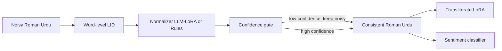

# Roman Urdu Normalizer — full project plan

## Supervisor change

**Fine-tune a small instruction LLM (LoRA) instead of training ByT5.** Same deliverables; Hugging Face + PEFT stack. Online related work (below) strongly supports this choice for *normalization*; for *transliteration*, published SOTA still often uses dedicated seq2seq (m2m100) — we stay on LLM-LoRA per supervisor, but train on the same large parallel data they use and report Char-BLEU/CHRF so numbers are comparable.

## Related work — who is ahead, and what we borrow

Honest gap analysis (what is already better than a from-scratch student project, and how we close it):

| Work | What they do well | Gap vs our brief | What we take |
|---|---|---|---|
| [COMI-LINGUA-TN](https://huggingface.co/LingoIITGN/COMI-LINGUA-TN) (Llama-3.1-8B LoRA on noisy Hinglish → standard) | Closest “normalize informal romanized Indic” recipe; LoRA beats zero/few-shot LLMs | Hindi–English, not Roman Urdu; no confidence gate / downstream F1 in the card | **Prompt + LoRA hyperparams** (r=32, α=64, 3 epochs, LR 2e-4) as starting point; keep English unchanged in instructions |
| [VarDial 2025 — LLMs as Normalizer](https://aclanthology.org/2025.vardial-1.5.pdf) | LoRA on many 7B/13B models for roman → native script (Dakshina, 12 languages incl. Urdu) | Transliteration normalization, not social spelling canonicalization; larger models | Confirms **LoRA-SFT >> prompting** for this family of tasks; use Dakshina-style prompts |
| [LoResMT 2025 — m2m100 Roman↔Urdu](https://aclanthology.org/2025.loresmt-1.13/) ([arXiv](https://arxiv.org/abs/2503.21530)) | **SOTA transliteration**: Char-BLEU ~97; beats RNN and GPT-4o Mini; MLM pretrain + fine-tune on **Roman-Urdu-Parl + Dakshina** | Not social spelling normalization; not LLM-LoRA | Use **Roman-Urdu-Parl** ([HF split](https://huggingface.co/datasets/Mavkif/Roman-Urdu-Parl-split)) + Dakshina for our transliterate adapter; report **Char-BLEU + CHRF** (not only CER/WER) so we can cite them fairly |
| [Roman-Urdu-Parl](https://dl.acm.org/doi/10.1145/3464424) (Alam & Hussain) | 6.37M Urdu↔Roman pairs — scale we do not have in v4 alone | Parallel transliteration corpus, not noisy→canonical Roman | Primary **transliteration** training data |
| [RUWV-NSR](https://data.mendeley.com/datasets/v5jfhsvtmd/5) ([paper](https://pmc.ncbi.nlm.nih.gov/articles/PMC11683287/)) | 5,244 words × up to 5 variants + “common” spelling; 28k sentiment reviews | Lexicon + sentiment data; weak sentence-level normalizer | Merge high-quality variant→common into our lexicon; cite for related sentiment data |
| [UrduPhone + Lex-C](https://aclanthology.org/D15-1097.pdf) (Rafae et al., EMNLP 2015) | Unsupervised clustering of Roman Urdu spelling variants (phonetic) | Discovers clusters, does not always pick a project-standard canonical | Optional enrichment / analysis of residual silver unknowns |
| [Khan & Karim 2012](https://doi.org/10.1109/ictai.2012.91) SMS normalizer | Classic **rule-based** Roman Urdu+English SMS standardization; +23% F1 on keyword task | Old, SMS-specific | Cite as historical rule baseline lineage; our `Normalizer` is the modern counterpart |
| Hate-speech / sentiment papers with ad-hoc lexicons (~4k words) | Show normalization helps classifiers | Lexicons not released as shared benchmarks; no calibrated abstention | Motivates our **downstream F1** experiment |
| [Indi-RomCoM](https://arxiv.org/abs/2606.30790) | Shows LLMs fail on romanized code-mix until QLoRA fine-tune | Broader Indic instruct bench | Justifies fine-tuning (not zero-shot) for the stretch LLM eval |

**Where published systems still beat us today**

- Transliteration accuracy at scale (m2m100 + 6M pairs) — we will not claim to beat Char-BLEU 97 with a 1.5B LoRA unless results say so; we *will* train on the same data family and report the same metrics.
- COMI-LINGUA uses an **8B** backbone; our default **1.5B** is easier on student GPUs — if results lag, bump to 3B/8B LoRA as an ablation.

**Where we can still be stronger / differentiated**

- Few works ship the full brief stack: **noisy social Roman → one canonical Roman**, **word LID**, **calibrated confidence (abstain)**, **Urdu script**, and **downstream sentiment ΔF1** in one pipeline.
- Our v4 data already has leakage-aware splits, real YouTube/Facebook comments, and a reviewed (pending human) social test — better evaluation hygiene than many scraped sentiment-only papers.
- Confidence gate (uncertain / EN / NE → leave unchanged) is rare in the Roman Urdu literature and matches the brief’s advanced component.

## Where you are now

The repo is **dataset-complete, model-empty**:

| Brief requirement | Status |
|---|---|
| Gold normalized pairs + lexicon | Done — [`dataset/data/v4/`](dataset/data/v4/), [`golden_pairs.csv`](golden_pairs.csv), lexicons |
| Rule-based baseline | Done inside [`dataset/build_v4.py`](dataset/build_v4.py) (`Normalizer`) — needs eval CLI |
| Preserve English in code-mix | Partial — need explicit LID + leave-unchanged gate |
| Learned normalizer | Missing — **QLoRA instruct LLM** |
| Transliterate → Urdu script | Missing — train on **Dakshina + Roman-Urdu-Parl** |
| Calibrated confidence | Missing |
| Downstream sentiment F1 | Missing — UCI labels in [`social_sentiment.jsonl`](dataset/data/v4/social_sentiment.jsonl) |
| Human-checked test gold | Not done |
| Stretch: LLM prompts | Not started |

**Defaults:** sentiment downstream; **Qwen2.5-1.5B-Instruct + QLoRA**; GPU (Colab/local); stretch last.

## Target architecture



## Phase 1 — Package baseline + related lexicons (1–2 days)

- Extract rule `Normalizer` → `src/rule_baseline.py`.
- `src/eval_normalize.py`: CER / WER per split (never pooled).
- Optional: import RUWV-NSR “Var-* → Common” into lexicon (cite Mendeley/Data in Brief); do not overwrite v4 conventions without a mapping table.
- Human review of [`annotation/social_test_gold.tsv`](dataset/annotation/social_test_gold.tsv).

## Phase 2 — Word-level LID (2–3 days)

- Token classifier on v4 `lang` labels (`UR` / `EN` / `NE` / `OTH`).
- Char n-grams + lexicon features.
- Probabilities feed the confidence gate.

## Phase 3 — LoRA normalize (follow COMI-LINGUA / VarDial)

- Base: **Qwen2.5-1.5B-Instruct** (ablate 0.5B / 3B if needed).
- QLoRA starting point from COMI-LINGUA-TN: rank 32, alpha 64, dropout 0.1, ~3 epochs, LR ~2e-4.
- Prompt style (adapted):

```text
Normalize noisy Roman Urdu to the project standard spelling.
Keep English words and names unchanged. Output only the normalized sentence.

Input: mujhy kl ghr jana h
Output: mujhe kal ghar jana hai
```

- Train on v4 `train.jsonl` (gold-heavy; subsample silver); early-stop on `dev`.
- Compare to **rule baseline** on all test splits (CER, WER).
- Error slices: names, English, elongations, `main`/`mein` / `he`.

## Phase 4 — Confidence + calibration (3–5 days)

- Mean generation logprob (+ optional agreement with rule baseline).
- Gate: conf &lt; τ or LID ∈ {EN, NE} → keep original token (align noisy vs output).
- Tune τ on `dev` for ECE + WER; report ECE on test.

## Phase 5 — Transliteration (same stack, bigger data)

- Second LoRA adapter (or multi-task instruction) trained on:
  - Dakshina Urdu ([`dataset/sources/dakshina_*.jsonl`](dataset/sources/))
  - **Roman-Urdu-Parl** leakage-safe split ([HF](https://huggingface.co/datasets/Mavkif/Roman-Urdu-Parl-split))
- Evaluate with **CER/WER + Char-BLEU + CHRF** on held-out Dakshina / RUP test — cite LoResMT 2025 as the number to beat.
- Pipeline: normalize Roman → transliterate; LID copies English Latin spans through.
- Do **not** claim to exceed m2m100 Char-BLEU unless measured; document compute/model-size gap.

## Phase 6 — Downstream sentiment (3–5 days)

- Classifier on raw vs rule-normalized vs LLM-normalized UCI text.
- Macro-F1 + bootstrap; this is the brief’s “advanced” proof.

## Phase 7 — Report + stretch

- Related-work table (above), metrics, calibration, name/English errors, ΔF1.
- Stretch: frozen general LLM with/without our normalizer in front (Indi-RomCoM-style motivation).

## Deliverables checklist

- Noisy Roman → consistent Roman (+ Urdu script) via **finetuned LLM**
- English preserved (LID + gate)
- LLM vs rules (+ literature context for transliteration SOTA)
- Word LID + calibrated confidence
- Downstream sentiment F1 before/after
- CER, WER, ECE, Char-BLEU/CHRF (translit), F1 + error analysis
- Data: v4 + cited external corpora/lexicons

## Code quality (non-negotiable)

Professional, minimal, readable — not a pile of notebooks or one-off scripts.

**Layout (flat and obvious):**

```text
src/
  data/           # load jsonl/csv, export SFT examples
  rules/          # rule baseline (thin wrap of existing Normalizer)
  lid/            # word language ID
  model/          # train / infer LoRA normalizer + transliterator
  confidence/     # gate + ECE
  eval/           # CER, WER, Char-BLEU, CHRF, F1
  pipeline.py     # one entry: noisy text → normalized (+ optional Urdu)
scripts/          # thin CLIs only: train_normalize.py, eval_all.py, ...
configs/          # yaml: model name, LoRA rank, paths, thresholds
```

**Rules we follow while coding:**

- One module ≈ one job; no god-files and no copy-paste across phases
- Names say what they are: `noisy_text`, `normalized_text`, `word_lang`, `confidence_threshold` — not `x`, `tmp2`, `data1`
- Public functions typed and documented in one short docstring (what in / what out)
- Prefer ~100–200 line modules; extract a helper when a function does two things
- Config in yaml/CLI args — no hard-coded paths or magic numbers buried in training loops
- Dataset build code stays in `dataset/`; model code never reimplements the v4 builder
- No unused imports, commented-out experiments, or dead notebooks in `src/`
- Each phase ends with a single command a teammate can run (e.g. `python scripts/eval_all.py --split test_social`)
- README section: install → train → eval → example normalize call

**What we deliberately avoid:** Jupyter as the source of truth, megascripts, unclear abbreviations, mixing train/eval/data prep in one file, silent failures.

## Team split

- **A:** LLM LoRA normalize + confidence
- **B:** rules + LID + transliteration (Parl/Dakshina) + Char-BLEU
- **C:** human review + sentiment downstream + related-work write-up

## First implementation slice (after approve)

1. Create the `src/` + `scripts/` + `configs/` skeleton above (empty `__init__.py`, clear names)  
2. Rule baseline wrapper + CER/WER eval (readable, typed)  
3. SFT jsonl export from v4  
4. Minimal QLoRA train script for normalize  
5. Note Roman-Urdu-Parl download for Phase 5 (large; plan disk/HF cache)